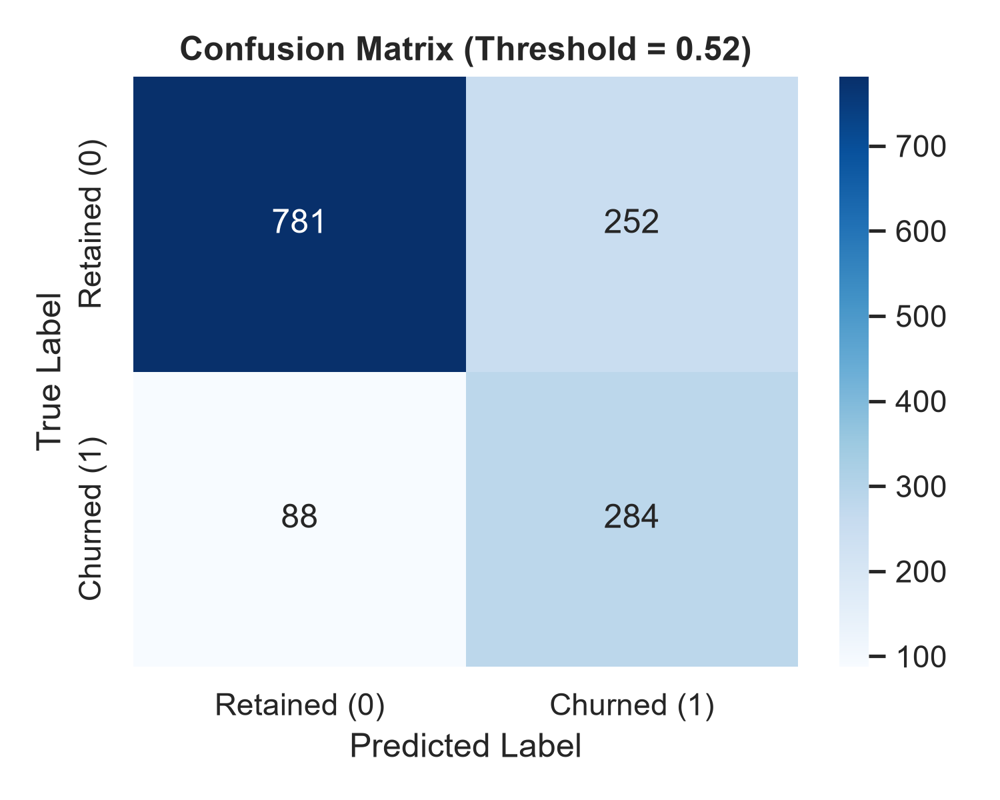
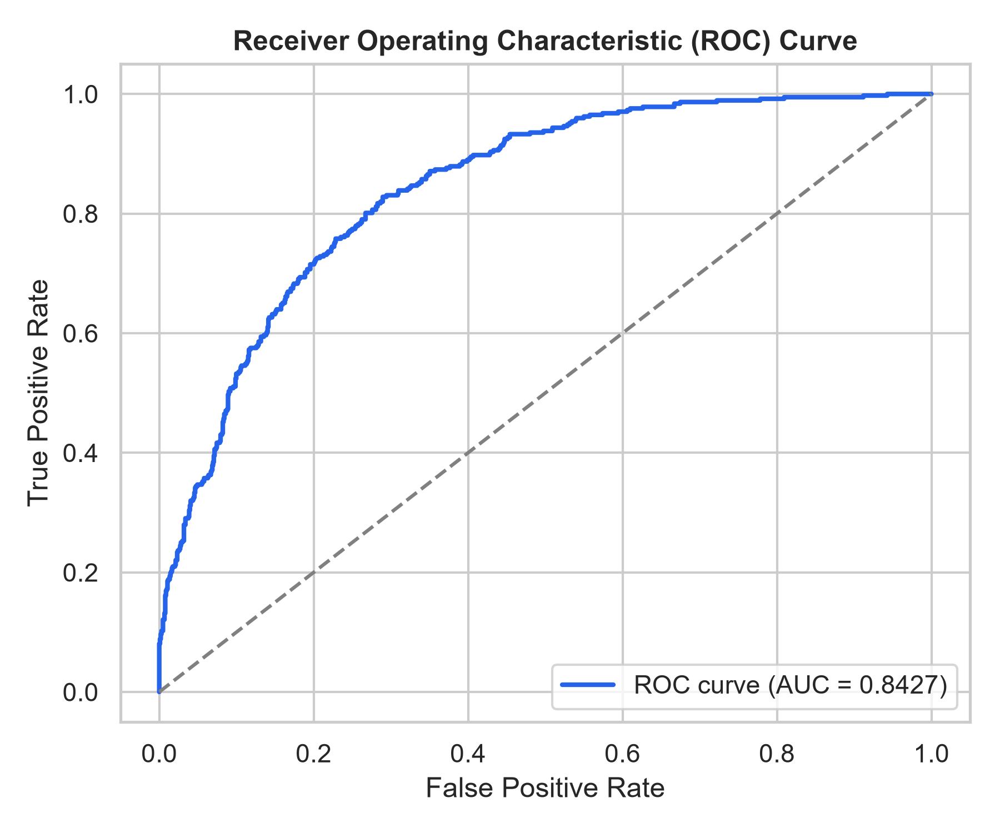
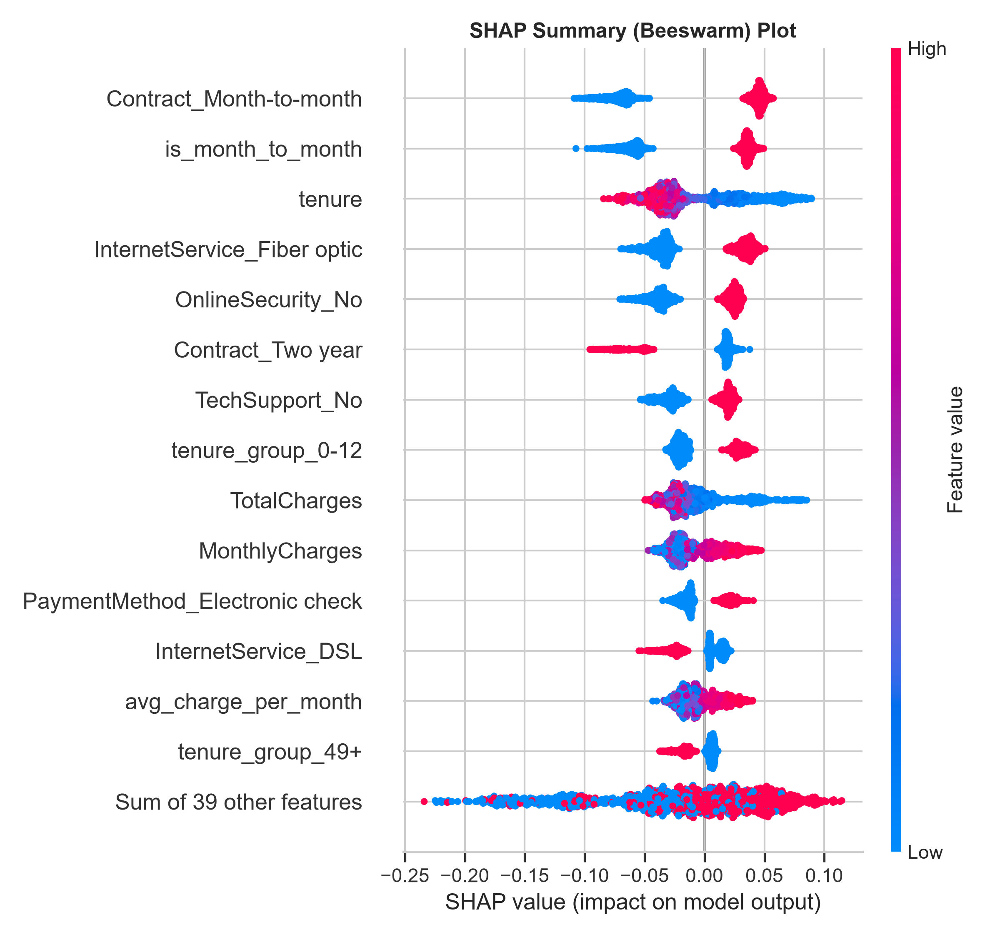
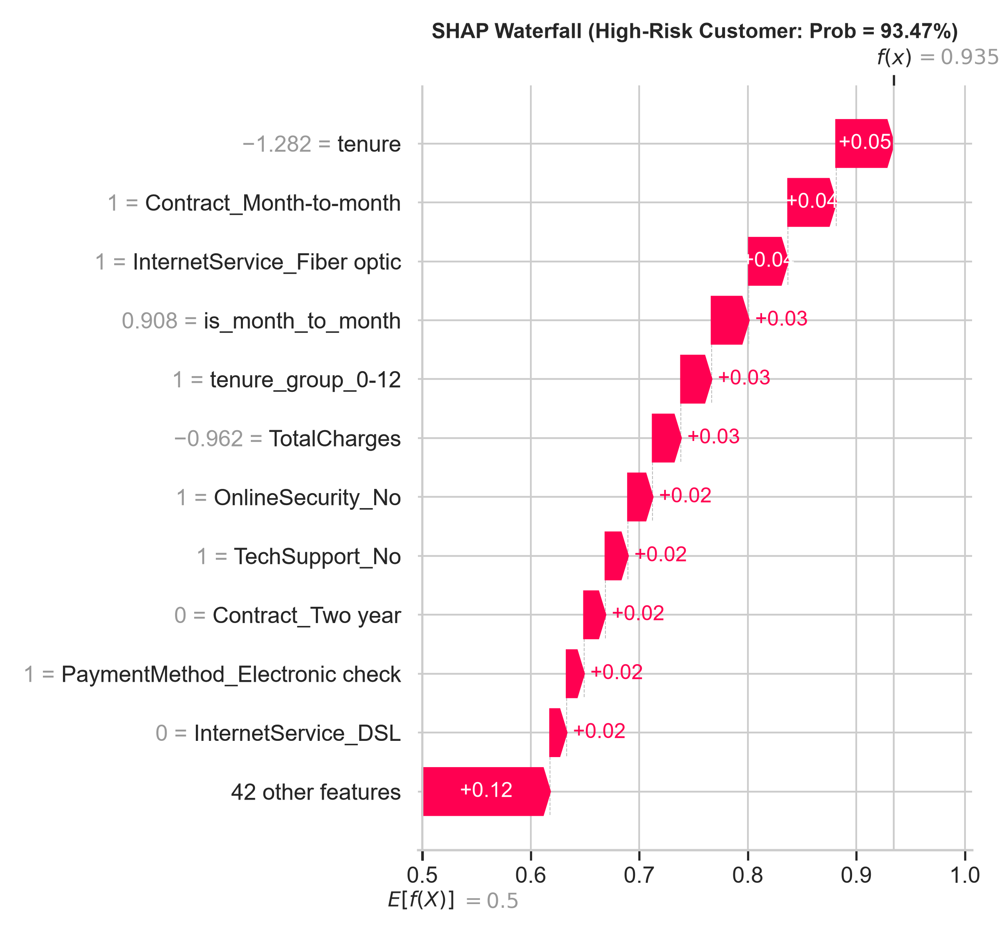

# Customer Churn Prediction & Explainability Platform

[](https://share.streamlit.io)
[](https://opensource.org/licenses/MIT)
[](https://www.python.org/downloads/)
[](https://scikit-learn.org/)

> End-to-end data science machine learning system to predict telecom customer attrition, interpret individual risk drivers using SHAP TreeExplainer, and deliver real-time single and batch scoring via a Streamlit web application.

---

## 📌 Problem Statement

Customer churn is one of the most critical revenue leakages for telecommunications companies. Because acquiring a new subscriber costs 5x to 10x more than retaining an existing one, retention teams require calibrated, explainable predictive models that identify flight-risk customers before they defect.

This project delivers:
1. **Calibrated Predictive Classifier**: Optimally tuned threshold to maximize customer recall while preserving marketing precision.
2. **Transparent Decision Explainability**: Real-time SHAP feature attributions pinpointing exact reasons for individual churn risk.
3. **Interactive Decision Platform**: Multi-tab Streamlit dashboard enabling real-time scoring, batch CSV predictions, and business KPI monitoring.

---

## 📊 Dataset & Exploratory Insights

- **Source**: Public IBM Telco Customer Churn Dataset (7,021 customer records, 20 clean attributes).
- **Class Balance**: 26.45% churn rate (1,857 churners vs. 5,164 retained).

### Key Empirical Findings:
- **Contract Duration**: Customers on **Month-to-month contracts exhibit 42.64% churn**, compared to **11.27% on One-year** and **2.83% on Two-year contracts**.
- **Tenure Vulnerability**: Median tenure for churners is **10.0 months**, compared to **38.0 months** for loyal customers.
- **Service Type**: Subscribers with **Fiber Optic churn at 41.78%**, versus **18.89% on DSL** and **7.21% on No Internet**.
- **Payment Channels**: Electronic check users churn at **45.15%**, versus ~**16%** for automated credit card or bank debit methods.

---

## ⚙️ Approach & Architecture

1. **Feature Engineering**:
   - `tenure_group`: Discretized customer lifetime bins (`0-12`, `13-24`, `25-48`, `49+` months).
   - `avg_charge_per_month`: Ratio of `TotalCharges / max(tenure, 1)` to capture billing anomalies.
   - `num_services`: Integer count of active internet security and entertainment add-on subscriptions.
   - Interaction flags: `has_internet`, `is_month_to_month`.
2. **Strict Data Leakage Protection**:
   - Split 80/20 train/test stratified on the target with `random_state=42`.
   - All standard scaling, imputation, and one-hot encoding fitted **strictly on the training partition**. Held-out test set touched only for final audit.
3. **Model Selection & Tuning**:
   - 5-Fold Stratified Cross-Validation across Logistic Regression, Random Forest, and XGBoost.
   - `RandomizedSearchCV` hyperparameter optimization on top performers.
   - Post-tuning threshold optimization targeting maximum validation F1-score.

---

## 📈 Held-Out Test Set Results

Evaluated strictly on **1,405 held-out customer records** (1,033 retained, 372 churned) at optimal decision threshold **0.52**:

| Metric | Held-Out Test Score | Business Impact |
| :--- | :--- | :--- |
| **Accuracy** | **75.80%** | Robust overall generalization across both customer cohorts |
| **ROC-AUC** | **0.8427** | Superior ranking ability separating churners from non-churners |
| **PR-AUC** | **0.6632** | Strong precision-recall balance on imbalanced positive target |
| **Recall (Sensitivity)** | **76.34%** | **Intercepts 284 out of 372 actual churners** before churn occurs |
| **Precision** | **52.99%** | More than 1 in 2 flagged accounts are verified flight risks |
| **F1-Score** | **0.6256** | Harmonic mean optimizing intervention ROI |

### Confusion Matrix Breakdown:
- **True Negatives (TN)**: 781
- **False Positives (FP)**: 252 (acceptable low-cost retention offers)
- **False Negatives (FN)**: 88 (missed churners)
- **True Positives (TP)**: 284 (intercepted churners)

---

## 🔍 Model Explainability & Visualizations

### 1. Confusion Matrix & ROC Curve



### 2. SHAP Global Feature Impact (Summary Beeswarm)
SHAP TreeExplainer confirms tenure, contract structure (month-to-month), fiber optic service, and payment methods dominate model predictions.



### 3. Individual Customer Waterfall Attribution
Waterfall explanation decomposing individual churn risk probability:



---

## 🛠️ Project Structure

```
churn-prediction/
├── data/
│   ├── raw/                 # Original IBM Telco CSV
│   └── processed/           # Cleaned dataset (clean.csv)
├── notebooks/
│   └── 01_eda.ipynb         # Exploratory Data Analysis notebook
├── src/
│   ├── config.py            # Paths, random seeds, and tuned threshold
│   ├── data.py              # Data loading, typing, and cleaning
│   ├── features.py          # Feature engineering & ColumnTransformer pipeline
│   ├── train.py             # Model training, CV, hyperparameter & threshold tuning
│   ├── evaluate.py          # Held-out evaluation, metrics, and SHAP plots
│   └── predict.py           # Cached inference module with SHAP explanations
├── models/
│   ├── churn_model.joblib   # Trained production pipeline (< 100 MB)
│   └── model_card.json      # Model metadata, parameters, and versions
├── reports/
│   ├── figures/             # Diagnostic curves, charts, and SHAP diagrams
│   ├── metrics.json         # Real held-out evaluation numbers
│   ├── model_comparison.csv # CV comparison across evaluated models
│   ├── eda_insights.md      # Quantitative EDA bullets
│   └── results.md           # Business results and drivers interpretation
├── app/
│   └── app.py               # Streamlit application (Single & Batch scoring)
├── tests/
│   └── test_churn.py        # Pytest test suite
├── Dockerfile               # Production containerization
├── .dockerignore
├── requirements.txt         # Pinned production dependencies
├── DEPLOYMENT.md            # Streamlit Cloud, HF Spaces, and Render guide
└── README.md
```

---

## 💻 How to Run Locally

### 1. Clone & Set Up Virtual Environment
```bash
git clone https://github.com/<your-username>/churn-prediction.git
cd churn-prediction

python -m venv .venv
# Windows:
.\.venv\Scripts\activate
# macOS/Linux:
source .venv/bin/activate

pip install -r requirements.txt
```

### 2. Train and Evaluate Pipeline
```bash
# Run data cleaning
python -m src.data

# Train and tune models
python -m src.train

# Evaluate on held-out test set
python -m src.evaluate
```

### 3. Run Test Suite
```bash
pytest -v tests
```

### 4. Launch Streamlit Dashboard
```bash
streamlit run app/app.py
```
Open your browser at `http://localhost:8501`.

---

## 🐳 Docker Deployment

Build and run containerized application:

```bash
docker build -t churn-prediction .
docker run -p 8501:8501 churn-prediction
```

*(Note: If Docker is not installed on your system, run locally using the virtual environment commands above).*

---

## 🧰 Tech Stack

- **Core & Processing**: Python 3.10+, Pandas, NumPy
- **Machine Learning**: Scikit-Learn, XGBoost, Imbalanced-Learn, Joblib
- **Explainability**: SHAP (TreeExplainer)
- **Visualization**: Matplotlib, Seaborn
- **Web Interface**: Streamlit
- **Testing & Quality**: Pytest
- **Containerization**: Docker

---

## ⚠️ Limitations & Ethical Considerations

1. **Static Cross-Sectional Snapshot**: Dataset lacks longitudinal customer usage telemetry (e.g. weekly bandwidth spikes, customer care call transcripts).
2. **Demographic Proxies**: Features like `SeniorCitizen` or `Partner` must be reviewed to ensure discount campaigns comply with fair lending and consumer protection guidelines.
3. **Intervention Fatigue**: High-frequency retention outreach on predicted churners can cause customer annoyance if retention offers are not tailored.

---

## 🚀 Future Roadmap

- [ ] Ingest streaming telemetry data using Kafka / FastStream.
- [ ] Implement Uplift Modeling (Causal ML) to identify *persuadable* customers rather than customers who churn regardless of discounts.
- [ ] Automated model monitoring and drift detection with Evidently AI.

---

## 📄 License

This project is licensed under the [MIT License](LICENSE).
